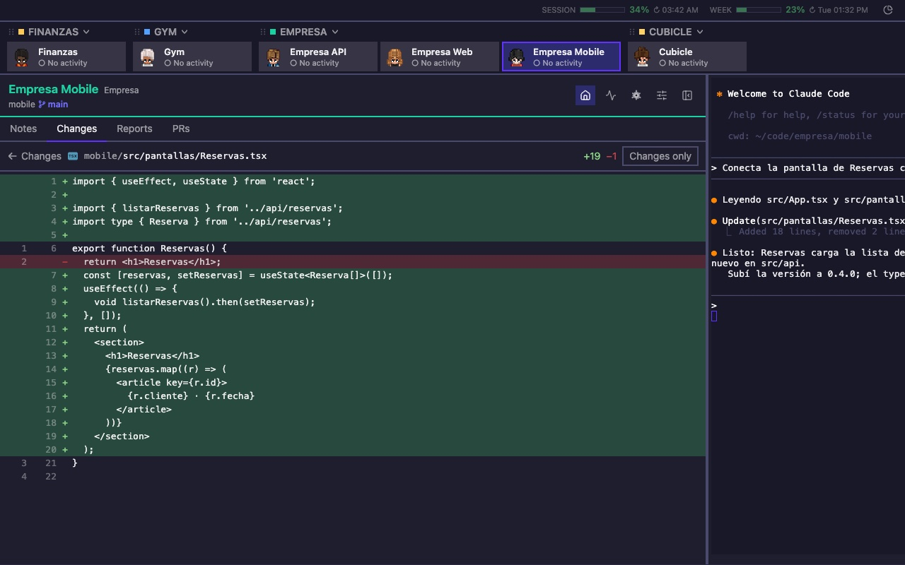
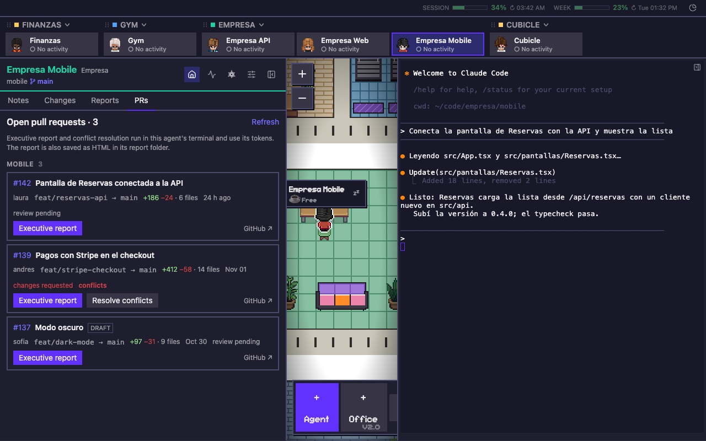
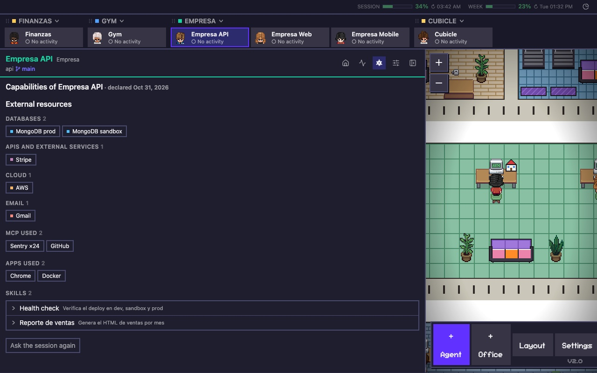

# Cubicle · v2.0

**Una oficina pixel-art para tus sesiones de Claude Code.** Cada proyecto es una sala y cada sesión un personaje. Un clic y tienes su terminal, sus cambios git, sus reportes y su actividad.

Fork de [Pixel Agents](https://github.com/pixel-agents-hq/pixel-agents) de Pablo De Lucca (MIT). Interfaz en español e inglés. Skin Pokémon opcional.

> **English:** a pixel-art command center for your Claude Code sessions: one room per project, one character per session, terminal + git changes + HTML reports + PR review + activity, project cards, usage meters, optional Pokémon skin, one-command install. Fork of Pixel Agents (MIT). UI in English and Spanish.

## Qué cambia

| Antes | Con Cubicle |
|---|---|
| Un IDE por proyecto para ver qué tocó Claude | Pestaña **Cambios**: árbol y diff por repo, al lado de la terminal |
| Notas en cualquier parte | **Notas** por proyecto, compartidas por sus sesiones |
| Revisar PRs a mano | **PRs**: Claude hace el informe ejecutivo de cada PR y resuelve los conflictos del que le pidas |

## Instalación

Requisitos: macOS (Linux sin arranque automático), [Claude Code](https://docs.anthropic.com/claude-code) ya usado, Node 20+ y Python 3.

```bash
git clone https://github.com/YeisonGomez/cubicle.git cubicle
cd cubicle
./install.sh        # dependencias, compilación, statusline y el comando `cubicle`
cubicle install     # queda en segundo plano y arranca sola al iniciar sesión (macOS)
cubicle open        # abre la oficina en el navegador
```

| Comando | Qué hace |
|---|---|
| `cubicle install` / `uninstall` | Registra o quita el arranque automático (launchd). Sin terminal abierta; se reinicia sola si se cae |
| `cubicle open` | Abre `http://127.0.0.1:3100/?token=…` |
| `cubicle restart` | Reinicia y reanuda tus sesiones. Para actualizar: `git pull && ./cubicle-build.sh && cubicle restart` |
| `cubicle status` · `stop` · `start` · `logs` | Lo que dicen. Sin `install`, `start` corre en la terminal actual |

Nunca arranques la oficina desde dentro de una sesión de Claude.

## Primer arranque

Cubicle detecta las carpetas donde usaste Claude Code la última semana y las propone agrupadas: una carpeta con sesión que contiene otras con sesión es una **oficina**; ella y sus hijas, sus **agentes**. Ajustas nombres, eliges idioma y skin, y listo. Después: **+ Oficina**, **+ Agent** o Settings → Importar sesiones.

## Recorrido

### La oficina

Una sala por proyecto, un personaje por sesión, con su estado. Arriba, las fichas por sala; a la derecha, el uso de tu cuenta.


### Terminal y panel

Clic en un personaje o en su ficha: terminal a la derecha, panel a la izquierda.


### Cambios

Archivos sin commit de cada repo del agente, con diff.



### Reportes

Los `*.html` de `docs/reports/` del proyecto, dentro del panel o a pantalla completa.

**Nuevo reporte**: describes qué quieres ver y la sesión lo genera.

Es HTML directo en tu repo: lo personalizas como quieras y no llenas el proyecto de artefactos.


### PRs

Los PRs abiertos de cada repo.

**Informe ejecutivo**: Claude revisa el PR por su naturaleza, no por su tamaño, y deja el informe en la terminal y como HTML en Reportes.

**Resolver conflictos**: lo hace en un worktree aparte y pregunta antes de hacer push.



### Actividad

Prompts por día y por hora, días de la semana y prompts por semana.


### Capacidades

Bases de datos, APIs, nube, correo, MCP, apps y skills de cada sesión, declarados por ella misma la primera vez.



### Consumo

Tokens por sala y agente: hoy, 7 días, 30 o todo. Sale de los transcripts.


### Ficha de proyecto

Clic en el nombre de una sala: qué es el proyecto, agentes con su rol, subcarpetas con repo, rama y último commit. Lo escribe una sola vez la propia sesión.


### Personajes: clásico o Pokémon

En Ajustes → Personajes. Con **Pokémon**, cada oficina es un tipo (fuego, agua, planta…) con sus colores y su piso, y cada agente un Pokémon al azar de ese tipo, animado.


Sprites del proyecto [vscode-pokemon](https://github.com/jakobhoeg/vscode-pokemon) (CC0), cargados en el navegador; no se guardan aquí. Pokémon es propiedad de The Pokémon Company, Nintendo y Game Freak; homenaje para uso personal, sin afiliación.

## Desarrollo

- Solo webview: `cd pixel-agents-src/webview-ui && npx tsc -b && npx vite build` y recargar.
- Servidor: `./cubicle-build.sh` y `cubicle restart`.
- Probar aparte: `HOME=<tmp> OFICINA_DIR=<tmp>/datos node pixel-agents-src/dist/cli.js --port 3200 --allowed-host prueba.local`.

## Créditos y licencia

[Pixel Agents](https://github.com/pixel-agents-hq/pixel-agents) © Pablo De Lucca, MIT (base v1.5.0). Cubicle, MIT. Ver `LICENSE`.
