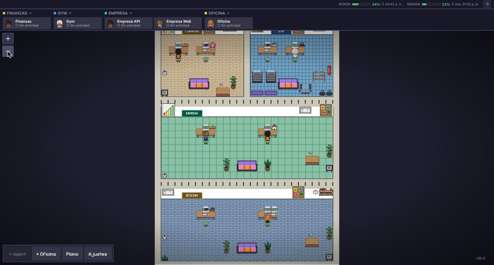
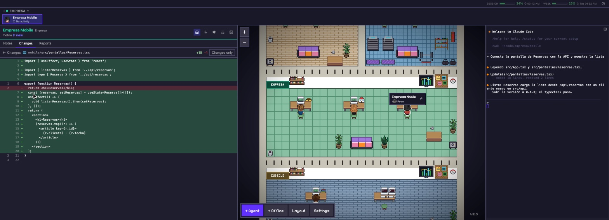
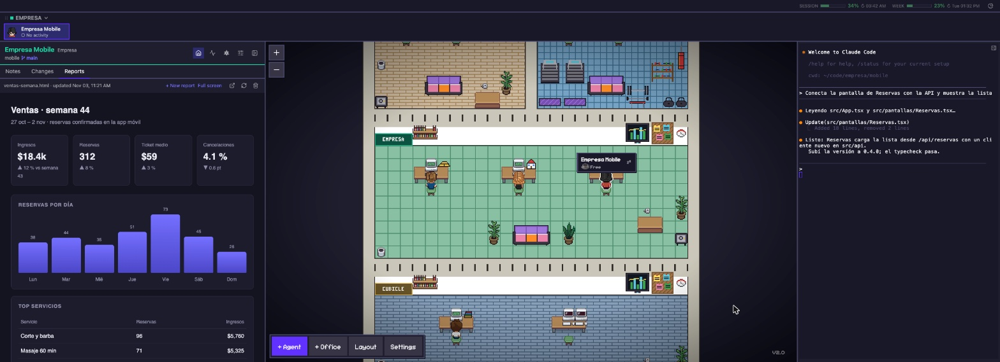
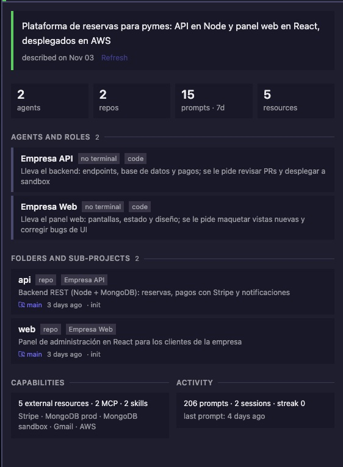
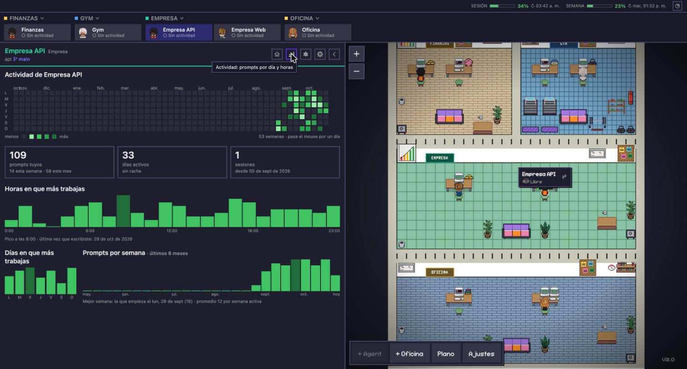
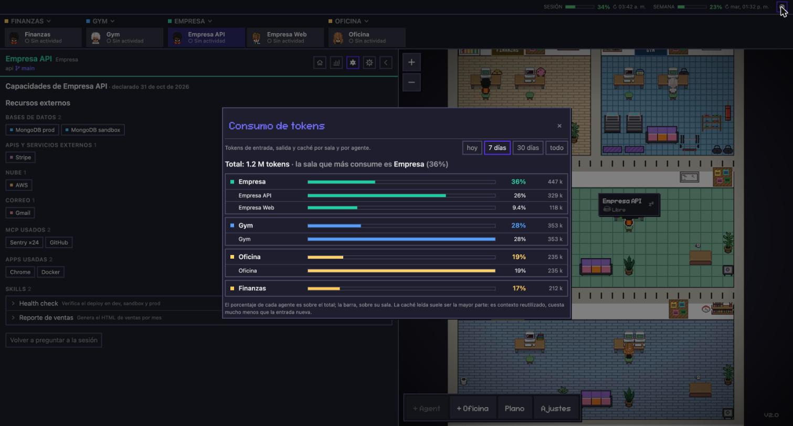
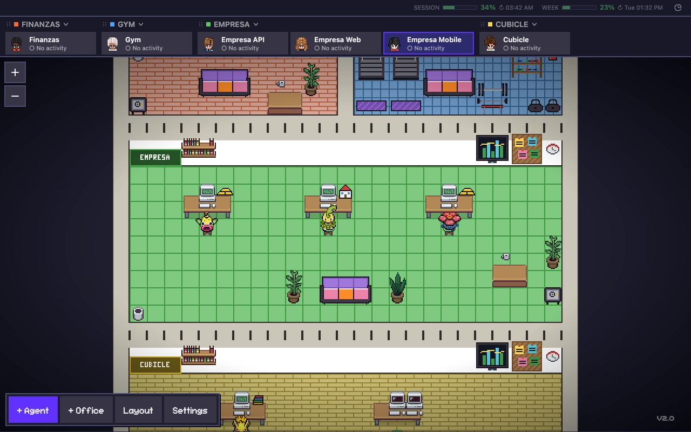

# Cubicle · v2.0

**Una oficina pixel-art para tus sesiones de Claude Code.** Cada proyecto es una sala y cada sesión un personaje. Un clic y tienes su terminal, sus cambios git, sus reportes y su actividad. Sin IDE abierto por proyecto, sin diez pestañas.

Fork de [Pixel Agents](https://github.com/pixel-agents-hq/pixel-agents) de Pablo De Lucca (MIT). Interfaz en español e inglés. Skin Pokémon opcional.

> **English:** a pixel-art command center for your Claude Code sessions: one room per project, one character per session, terminal + git changes + HTML reports + activity, PR review, project cards, usage meters, optional Pokémon skin, one-command install. Fork of Pixel Agents (MIT). UI in English and Spanish.



## Qué cambia

| Antes | Con Cubicle |
|---|---|
| Un IDE por proyecto para ver qué tocó Claude | Pestaña **Cambios**: árbol y diff por repo, al lado de la terminal |
| Reportes como artefactos sueltos | Pestaña **Reportes**: HTML del proyecto, dentro del panel |
| Terminales sin saber cuál es cuál | Un personaje por sesión, en su sala, con su estado |
| ¿Cuánto llevo de mi cuenta? ¿En qué? | Medidor de sesión y semana, consumo por sala y agente |

## Instalación

Requisitos: macOS (Linux sin arranque automático), [Claude Code](https://docs.anthropic.com/claude-code) ya usado, Node 20+ y Python 3.

```bash
git clone https://github.com/YeisonGomez/cubicle.git cubicle
cd cubicle
./install.sh        # dependencias, compilación, statusline y el comando `cubicle`
cubicle install     # queda en segundo plano y arranca sola al iniciar sesión (macOS)
cubicle open        # abre la oficina en el navegador
```

| Comando | Qué hace |
|---|---|
| `cubicle install` / `uninstall` | Registra o quita el arranque automático (launchd). Sin terminal abierta; se reinicia sola si se cae |
| `cubicle open` | Abre `http://127.0.0.1:3100/?token=…` |
| `cubicle restart` | Reinicia y reanuda tus sesiones. Para actualizar: `git pull && ./cubicle-build.sh && cubicle restart` |
| `cubicle status` · `stop` · `start` · `logs` | Lo que dicen. Sin `install`, `start` corre en la terminal actual |

Nunca arranques la oficina desde dentro de una sesión de Claude.

## Primer arranque

Cubicle detecta las carpetas donde usaste Claude Code la última semana y las propone agrupadas: una carpeta con sesión que contiene otras con sesión es una **oficina**; ella y sus hijas, sus **agentes**. Ajustas nombres, eliges idioma y skin, y listo. Después: **+ Oficina**, **+ Agent** o Settings → Importar sesiones.

## Recorrido

### Terminal y Cambios

Clic en un personaje o en su ficha: se abre su terminal a la derecha y su panel a la izquierda. **Cambios** muestra los archivos sin commit de cada repo del agente, con diff.



### Reportes

Los `*.html` de `docs/reports/` del proyecto, dentro del panel y a pantalla completa para presentar. **Nuevo reporte**: describes qué quieres ver y la sesión lo genera. Es HTML directo en tu repo, personalizable, sin llenar el proyecto de artefactos.



### Ficha de proyecto

Clic en el nombre de una sala (barra o letrero): qué es el proyecto en una línea, agentes con su rol, subcarpetas con repo, rama y último commit. Lo escribe una sola vez la propia sesión, leyendo su `CLAUDE.md` o README; Cubicle lo recuerda.



### Actividad, capacidades y consumo

- **Actividad**: mapa de calor de prompts por día y por hora.
- **Capacidades**: bases de datos, APIs, nube, MCP, apps y skills de cada sesión, declaradas por ella misma la primera vez.
- **Consumo**: tokens por sala y agente (hoy, 7 días, 30, todo). Sale de los transcripts.
- **PRs** (opcional): PRs abiertos de cada repo; informe ejecutivo o resolución de conflictos con un clic, hechos por la sesión.





### La oficina

Salas por filas, cada una con tema y letrero. En la pared, la biblioteca crece con los archivos del proyecto, el televisor abre sus reportes y el tablero sus notas. Las fichas de la barra se arrastran y se fijan. Cuando una sesión termina o te pregunta algo mientras no la miras, su ficha late y el personaje salta; se calma al abrirla. Sin prompts en dos semanas, el personaje se va al sofá.

### Personajes: clásico o Pokémon

En Ajustes → Personajes (o en el primer arranque). Con **Pokémon**, cada oficina es un tipo (fuego, agua, planta, eléctrico…) con sus colores y su piso, y cada agente un Pokémon al azar de ese tipo, de las dos primeras generaciones, animado. "Volver a sortear" reparte otros.



Sprites del proyecto [vscode-pokemon](https://github.com/jakobhoeg/vscode-pokemon) (CC0), cargados en el navegador; no se guardan aquí. Pokémon es propiedad de The Pokémon Company, Nintendo y Game Freak; este skin es un homenaje para uso personal, sin afiliación.

## Dónde vive cada cosa

| Qué | Dónde |
|---|---|
| Código (servidor + webview) | `pixel-agents-src/` (`server/src/office/`, `webview-ui/src/components/`, `hooks/`, `i18n/`) |
| Scripts | `scripts/`: `proyecto.py` (salas), `proyecto_info.py` (ficha), `capacidades.py`, `nota.py`, `gen_layout.py`, `gen_assets.py`, `pokemon.json`, `prompts/` |
| Tus datos | `~/.pixel-agents/oficina/` y `~/.pixel-agents/config.json`. Nada tuyo entra al repo |
| Servicio y registro | `~/Library/LaunchAgents/com.cubicle.office.plist`, `~/.pixel-agents/cubicle.log` |

## Desarrollo

- Solo webview: `cd pixel-agents-src/webview-ui && npx tsc -b && npx vite build` y recargar.
- Servidor: `./cubicle-build.sh` y `cubicle restart`.
- Probar aparte: `HOME=<tmp> OFICINA_DIR=<tmp>/datos node pixel-agents-src/dist/cli.js --port 3200 --allowed-host prueba.local`.

## Créditos y licencia

[Pixel Agents](https://github.com/pixel-agents-hq/pixel-agents) © Pablo De Lucca, MIT (base v1.5.0). Cubicle, MIT. Ver `LICENSE`.
