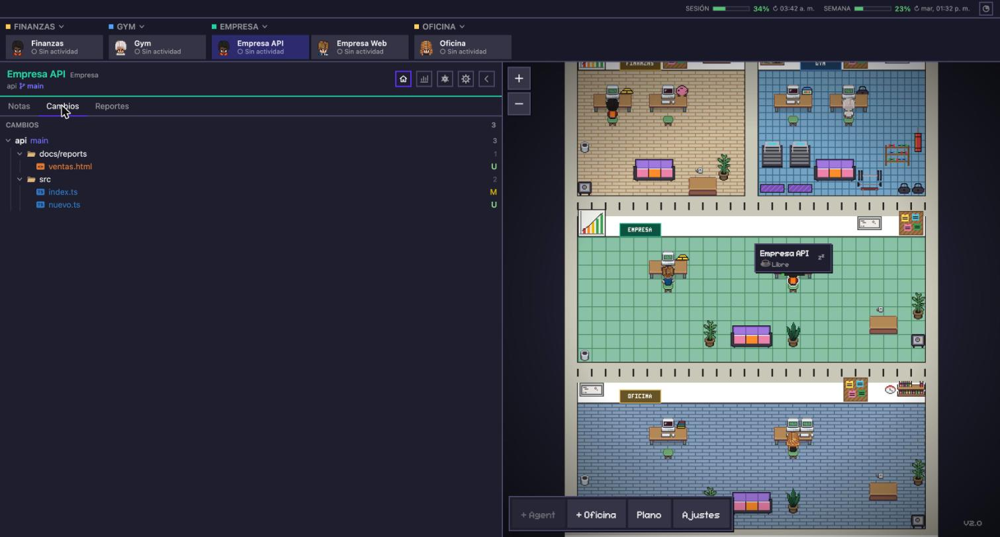
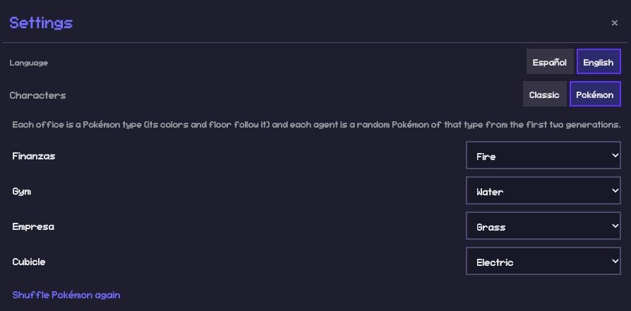

# Cubicle · v2.0

**Un centro de mando pixel-art para todas tus sesiones de Claude Code.** Cada sesión es un personaje sentado en la sala de su proyecto; haces clic y tienes su terminal, sus cambios git, sus reportes, su actividad y lo que sabe hacer. Sin IDE, sin diez pestañas abiertas.

Construido sobre un fork de [Pixel Agents](https://github.com/pixel-agents-hq/pixel-agents) de Pablo De Lucca (MIT): a él le debemos la oficina animada, los personajes, el editor de salas y la integración con los hooks y transcripts de Claude Code. Esta versión agrega todo lo que hay debajo. Interfaz en **español e inglés**, y si quieres, tus sesiones son **Pokémon**.

> **English:** a pixel-art command center for your Claude Code sessions: one room per project, one character per session, with an IDE-like side panel (notes, git changes, HTML reports, PR review, activity heatmap, capabilities), a project card per room, an integrated terminal, account usage meters, an optional Pokémon skin and a one-command install that runs in the background. Fork of Pixel Agents (MIT). UI available in English and Spanish.


## Qué cambia en tu día

| Antes | Con la oficina |
|---|---|
| Un IDE abierto por proyecto para ver qué tocó Claude | Pestaña **Cambios**: árbol estilo VS Code con diff, por repo, con la rama actual visible |
| Una pestaña del navegador por cada reporte HTML | Pestaña **Reportes**: los HTML del proyecto dentro del panel, con pantalla completa para presentar y "Nuevo reporte" que se lo pide a la sesión |
| Terminales sueltas, sin saber cuál es cuál | Un personaje por sesión en su sala; clic y aparece su terminal; estados cortos (💻 Ejecutando, ✋ Necesita permiso, ☕ Libre) |
| Abrir y cerrar sesiones a mano | **+ Agent** crea una sesión en cualquier carpeta en segundos; 🗑️ la quita; al reiniciar todo se reanuda solo |
| Sesiones abandonadas mezcladas con las activas | Las que llevan dos semanas sin prompt se van al **sofá** y salen de la barra; vuelven al escribirles |
| ¿Cuánto llevo usado de mi cuenta? ¿En qué proyecto? | Medidor de **sesión y semana** arriba, y **Consumo** de tokens por sala y agente |
| ¿A qué accede cada sesión? | **Capacidades**: bases de datos, APIs, nube, correo, MCP, apps y skills, declaradas por la propia sesión |
| ¿Qué era este proyecto y quién hace qué? | **Ficha de proyecto**: una línea que escribe la propia sesión, el rol de cada agente y todas las subcarpetas con su repo, rama y último commit |
| Revisar PRs a mano | Pestaña **PRs**: los abiertos de cada repo, un informe ejecutivo o la resolución de conflictos con un clic, hechos por la sesión |

## Instalación

Requisitos: macOS (o Linux, sin arranque automático), [Claude Code](https://docs.anthropic.com/claude-code) ya usado al menos una vez, Node 20+ y Python 3.

```bash
git clone https://github.com/YeisonGomez/cubicle.git cubicle
cd cubicle
./install.sh        # dependencias, compilación, statusline y el comando `cubicle`
cubicle install     # deja la oficina corriendo en segundo plano y abre sola al iniciar sesión
cubicle open        # la abre en el navegador
```

`install.sh` instala dependencias, compila, enlaza el comando `cubicle` en tu PATH y, si no tienes una, configura la statusline de Claude Code (es lo que entrega los límites de uso de la cuenta). Nunca arranques la oficina desde dentro de una sesión de Claude.

### Arrancar, parar, reiniciar

| Comando | Qué hace |
|---|---|
| `cubicle install` | macOS: registra la oficina en launchd. Arranca sola al iniciar sesión, se reinicia si se cae y no necesita ninguna terminal abierta. Al reiniciar reanuda tus sesiones (`--relaunch`) |
| `cubicle open` | Abre `http://127.0.0.1:3100/?token=…` en el navegador |
| `cubicle status` | Si está corriendo, en qué URL y si el arranque automático está instalado |
| `cubicle restart` | Reinicia (por ejemplo tras actualizar el código con `git pull && ./cubicle-build.sh`) |
| `cubicle stop` / `cubicle start` | Para y arranca. Sin `install`, `start` la corre en la terminal actual |
| `cubicle logs` | Sigue el registro (`~/.pixel-agents/cubicle.log`) |
| `cubicle uninstall` | Quita el arranque automático |

Para actualizar a una versión nueva: `git pull`, `./cubicle-build.sh` y `cubicle restart`. El puerto se cambia con `OFICINA_PORT`.

## Primer arranque

Sin nada configurado, la oficina detecta las carpetas donde usaste Claude Code en la última semana y te las propone agrupadas: una carpeta con sesión que contiene otras carpetas con sesión es una **oficina**, y ella y sus hijas son sus **agentes**. Cambias nombres en el sitio, marcas lo que quieres, eliges idioma y el skin de los personajes (clásico o Pokémon) y listo.


Después puedes agregar más con **+ Oficina** (carpeta nueva o existente, con tema) y **+ Agent** (una sesión más dentro de una oficina), o desde Settings → "Importar sesiones".

## Recorrido

### La oficina y la barra

Salas por filas (vida personal · trabajo · proyectos personales), cada una con tema, suelo y letrero de su color; en la pared, la biblioteca crece con los archivos del proyecto, el televisor abre sus reportes y el tablero sus notas. Arriba, las fichas de los agentes agrupadas por sala, arrastrables y fijables con la chincheta; a la derecha, el uso de tu cuenta (sesión de 5 h y semana) y el botón de consumo. Clic en una ficha o en un personaje abre su terminal y su panel; clic sobre la ficha ya seleccionada abre el menú (descansar, quitar). Cuando una sesión termina o te pregunta algo mientras no la miras, su ficha late, el personaje da saltitos y, si la pestaña está en segundo plano, te llega una notificación; se calma al abrirla. Solo pasea quien está libre: trabajando se queda en su puesto y descansando, en el sofá.

### Ficha de proyecto

Clic en el nombre de una sala en la barra o en su letrero en la oficina: a la derecha aparece la ficha del proyecto. Qué es en una línea, los agentes con su rol y estado, todas las subcarpetas (cuáles son repos, su rama y último commit, si tienen `CLAUDE.md`) y un resumen de capacidades y actividad. La descripción, los roles y las subcarpetas los escribe **una sola vez la propia sesión** de la sala, leyendo su `CLAUDE.md` o README; Cubicle lo recuerda y solo vuelve a preguntar si pulsas Actualizar.


### Panel por agente



- **Notas**: tablero de la sala, compartido por sus agentes.
- **Cambios**: archivos sin commit de cada repo del agente, con iconos y colores por tipo, guías de nivel y diff verde/rojo. La rama actual va en la cabecera.
- **Reportes**: los `*.html` de `docs/reports/` (o las carpetas que elijas). Pantalla completa con cambio entre reportes para presentar, y "Nuevo reporte": describes qué quieres ver y la sesión lo crea.


- **Actividad**: mapa de calor de tus prompts por día, horas y días de la semana en que más trabajas, prompts por semana. La historia se guarda aunque borres sesiones.


- **Capacidades**: a qué accede esa sesión fuera del proyecto (bases de datos, APIs y servicios, nube, correo), MCP que usa con conteo real, apps y skills con explicación en lenguaje natural. La primera vez que se lanza un agente, la oficina se lo pregunta a la sesión y ella lo registra sola.


- **Configuración**: nombre del agente, repositorios conocidos, carpetas de reportes y revisión de PRs.
- **PRs** (si activas la revisión): los PRs abiertos de cada repo vía `gh`. "Informe ejecutivo" le pide a la sesión una revisión por naturaleza del cambio, no por tamaño, con veredicto y hallazgos, en la terminal y como HTML en Reportes. "Resolver conflictos" lo hace en un worktree aparte y te pregunta antes de hacer push.

Todo prompt que la oficina manda a una sesión (capacidades, ficha, PRs, nuevo reporte) va en el idioma de la app.

### Consumo de tokens

Por sala y por agente, en hoy, 7 días, 30 días o todo, con porcentajes. Sale de los transcripts, no gasta tokens.


### Personajes: clásico o Pokémon

En Ajustes → Personajes (y en el primer arranque) eliges el skin. Con **Pokémon**, cada oficina es un tipo (fuego, agua, planta, eléctrico, psíquico, roca y tierra, fantasma y siniestro, dragón y volador, hielo, bicho y veneno, lucha, normal): su color, su letrero y el tono del piso cambian al del tipo, y puedes cambiar el tipo de cada oficina con un desplegable. Cada agente recibe un Pokémon al azar de su tipo, de las dos primeras generaciones, sin repetir dentro de la sala; queda fijo hasta "Volver a sortear". La etiqueta muestra su nombre junto al del agente. Al volver a Clásico se restauran los colores originales.




Los sprites animados (quieto y caminando, estilo Mystery Dungeon) se cargan en el navegador desde el proyecto [vscode-pokemon](https://github.com/jakobhoeg/vscode-pokemon) de Jakob Hoeg (CC0) y no se guardan en Cubicle. Pokémon es propiedad de The Pokémon Company, Nintendo y Game Freak; este skin es un homenaje para uso personal, sin afiliación.

## Dónde vive cada cosa

| Qué | Dónde |
|---|---|
| Código del fork (servidor + webview) | `pixel-agents-src/` (nuestro: `server/src/office/`, `server/src/*.ts` de la oficina, `webview-ui/src/components/`, `components/panel/`, `hooks/`, `i18n/`) |
| Scripts | `scripts/`: `proyecto.py` (salas), `proyecto_info.py` (ficha), `capacidades.py`, `nota.py`, `gen_layout.py`, `gen_assets.py`, `pokemon.json` (tipos y Pokémon), `prompts/` (plantillas de PR en ES y EN) |
| Datos del usuario | `~/.pixel-agents/oficina/` (`oficinas.json`, `letreros.json`, `capacidades.json`, `actividad.json`, `proyectos.json`, `skin.json`, `idioma.json`, `layout-oficina.json`, `assets/`); cambia con `OFICINA_DIR` |
| Servicio y registro | `~/Library/LaunchAgents/com.cubicle.office.plist` (lo crea `cubicle install`), `~/.pixel-agents/cubicle.log` |
| Config de Pixel Agents | `~/.pixel-agents/config.json`, `layout.json`, `notes.json`, `usage.json` |

El repositorio no contiene datos de nadie: todo lo tuyo queda en `~/.pixel-agents/`.

## Scripts

```bash
python3 scripts/proyecto.py nuevo "Mi proyecto" ~/code/mi-proyecto --tema code --fila 3 --lanzar
python3 scripts/proyecto.py aplicar        # regenera muebles + plano y lo aplica en vivo
python3 scripts/proyecto.py lista
python3 scripts/nota.py "Mi proyecto" "revisar el deploy"
python3 scripts/capacidades.py pregunta "Mi proyecto"   # la pregunta que responde la sesión
python3 scripts/capacidades.py lista
python3 scripts/proyecto_info.py get "Mi proyecto"     # la ficha que escribió la sesión
```

Temas: `code`, `personal`, `finanzas`, `gym`, `cafe`, `cursos`, `fintech`, `inmobiliaria`, `hardware`.

## Desarrollo

- Solo webview: `cd pixel-agents-src/webview-ui && npx tsc -b && npx vite build` y recargar la pestaña.
- Servidor: `./cubicle-build.sh` y `cubicle restart`.
- Probar sin tocar tu oficina: `HOME=<tmp> OFICINA_DIR=<tmp>/datos node pixel-agents-src/dist/cli.js --port 3200 --allowed-host prueba.local`.

## Créditos y licencia

- [Pixel Agents](https://github.com/pixel-agents-hq/pixel-agents) © Pablo De Lucca, MIT. Base: v1.5.0.
- Oficina, MIT. Ver `LICENSE`.
